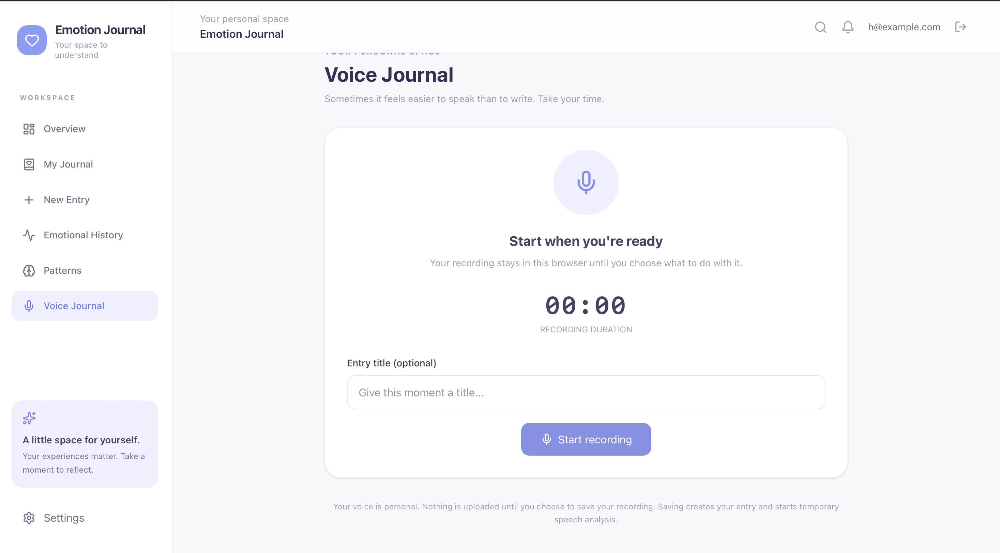

# Emotion AI Journal

Emotion AI Journal is an AI-assisted journaling application being developed to help people reflect on emotional experiences through text and voice entries.

The project explores how natural language processing and speech-based machine learning can provide emotion-related suggestions during journaling. These suggestions are intended to support personal reflection; they are not diagnoses or definitive assessments of a person's feelings.

> **Development note:** This project is a work in progress. The backend APIs and experimental text and speech analysis pipelines are being developed and tested alongside the frontend. Features, interfaces, model performance, and setup instructions may change as development continues.

## Project overview

The application is being built around two journaling approaches:

- **Text journaling:** users write about an experience and can request an AI-generated emotion suggestion.
- **Voice journaling:** users record an entry in the browser and can request an estimate of the emotion expressed in the audio.

The longer-term goal is to bring journal entries, emotion feedback, and reflection tools together in one application.

## Development progress

The following areas have working implementations or ongoing development. Their presence in this list does not imply that the complete application is finished or production-ready.

### Backend and journaling

- User registration and login using JWT-based authentication.
- Create, retrieve, update, and delete journal entries.
- Support for text-based and voice-based journal entries.
- Separate saving of journal entries and AI analysis results.
- API routes for text and speech analysis.
- Storage of analysis runs and model-generated emotion observations.
- Tracking of entry content versions so older analysis results can be identified.

### Voice-entry workflow

The voice-journaling workflow is being developed around the following sequence:

1. Record audio in the browser using the MediaRecorder API.
2. Pause, resume, stop, and preview the recording.
3. Save the recording as a voice-mode journal entry.
4. Submit the audio to the speech-analysis endpoint.
5. Preprocess the audio with FFmpeg and convert it to 16 kHz mono WAV.
6. Generate speech representations and run the emotion classifier.
7. Store the analysis run and its emotion observations.
8. Present the model's suggested vocal emotion to the user.

Saving an entry and analyzing its audio are separate operations. If analysis fails, the saved entry can remain available for a later retry.

Audio is processed using temporary files for inference. The project should not be described as permanently retaining recordings unless an explicit retention feature is implemented and users have consented to it.

## Technology stack

### Frontend

- React
- Vite
- React Router
- Axios
- Tailwind CSS
- Lucide React
- Recharts

### Backend

- Python
- FastAPI
- SQLAlchemy
- Alembic
- SQLite for current development and testing
- JWT authentication
- Argon2 password hashing
- Pydantic

### Machine learning and audio

- PyTorch
- Hugging Face Transformers
- Wav2Vec2 (`facebook/wav2vec2-base`)
- scikit-learn
- librosa
- FFmpeg

## Repository structure

The repository is organized by application layer. The exact structure may evolve during development.

```text
emotion-ai-journal-v2/
├── backend/
│   ├── app/
│   │   ├── api/
│   │   ├── core/
│   │   ├── models/
│   │   ├── schemas/
│   │   └── services/
│   ├── migrations/
│   └── tests/
├── frontend/
│   └── src/
│       ├── components/
│       ├── context/
│       ├── layouts/
│       ├── pages/
│       └── services/
├── ml/
│   └── models/
└── docs/
```

## Getting started

These instructions describe a local development setup. Dependency files and environment settings may need to be adjusted to match the current version of the repository.

### Prerequisites

- Python environment compatible with the backend dependencies.
- Node.js and npm.
- FFmpeg installed and available on your `PATH`.
- Git.

On macOS, FFmpeg can be installed with Homebrew:

```bash
brew install ffmpeg
```

### 1. Clone the repository

```bash
git clone <YOUR_REPOSITORY_URL>
cd emotion-ai-journal-v2
```

### 2. Set up the backend

```bash
cd backend
python3 -m venv .venv
source .venv/bin/activate
python -m pip install --upgrade pip
```

Install dependencies if a `requirements.txt` file is present:

```bash
pip install -r requirements.txt
```

Configure the backend environment according to the settings in `app/core/config.py` and the project's `pydantic-settings` configuration. Set a secure JWT secret and the database URL. Do not commit secrets or real credentials.

For local development with the SQLite test database:

```bash
DATABASE_URL="sqlite:///./emotion_journal_api_test.db" \
python -m uvicorn app.main:app --reload --port 8080
```

If the database setup uses Alembic migrations, run:

```bash
alembic upgrade head
```

When the backend starts successfully, the API is expected at:

- API: `http://127.0.0.1:8080`
- Interactive API documentation: `http://127.0.0.1:8080/docs`

Use a development or test database. Do not point experiments at a database containing important personal journal entries.

### 3. Set up the frontend

Open another terminal:

```bash
cd frontend
npm install
```

Create `frontend/.env` with the backend URL:

```env
VITE_API_URL=http://127.0.0.1:8080
```

Start the Vite development server:

```bash
npm run dev
```

Open the local URL printed by Vite, typically `http://localhost:5173`.

## API routes

The backend includes routes for authentication, journal-entry management, analysis, and feedback. The live API documentation at `/docs` should be treated as the source of truth for request and response schemas.

| Method | Endpoint | Purpose |
|---|---|---|
| `POST` | `/auth/register` | Register an account |
| `POST` | `/auth/login` | Authenticate and obtain a token |
| `GET` | `/auth/me` | Retrieve the authenticated user |
| `POST` | `/experiences/` | Create a journal entry |
| `GET` | `/experiences/` | List the user's entries |
| `GET` | `/experiences/{experience_id}` | Retrieve an entry |
| `PATCH` | `/experiences/{experience_id}` | Update an entry |
| `DELETE` | `/experiences/{experience_id}` | Delete an entry |
| `POST` | `/experiences/{experience_id}/analyze/text` | Analyze entry text |
| `POST` | `/experiences/{experience_id}/analyze/speech` | Analyze uploaded speech audio |
| `GET` | `/experiences/{experience_id}/analysis-runs` | Retrieve analysis runs |
| `PATCH` | `/experiences/{experience_id}/emotions/{emotion_id}/feedback` | Confirm or reject an emotion suggestion |

## Machine-learning experiments

### Text emotion analysis

The text-analysis service uses existing scikit-learn model artifacts to generate emotion suggestions.

The returned model scores should not be interpreted as normalized probabilities or as percentages of how much a person feels an emotion.

The existing artifacts were saved using a different scikit-learn version from the current backend environment. This is a known compatibility limitation. The artifacts need to be retrained and evaluated in a controlled environment before a production release.

### Speech emotion analysis

The speech pipeline uses Wav2Vec2 representations and a classifier trained for six emotion classes:

- Angry
- Disgust
- Fearful
- Happy
- Neutral
- Sad

In the current experimental evaluation, the model achieved approximately:

- **Test accuracy:** 0.62
- **Test macro F1:** 0.62

Cross-dataset evaluation was substantially weaker, indicating limited generalization across datasets and recording conditions. These experimental results do not establish clinical or real-world reliability.

A vocal-expression prediction is not necessarily the emotion a person is experiencing. The application should allow users to confirm, reject, or edit model suggestions.

## Frontend screenshots

Screenshots can be added here as the interface develops. The paths below are placeholders; replace them with screenshots captured from the running application.

| Screen | Suggested file |
|---|---|
| Login page | `docs/screenshots/login.png` |
| Main dashboard | `docs/screenshots/dashboard.png` |
| Text journal | `docs/screenshots/journal.png` |
| Voice journal | `docs/screenshots/voice-journal.png` |
| Voice recording preview | `docs/screenshots/voice-preview.png` |
| Speech analysis result | `docs/screenshots/speech-analysis-result.png` |

To embed a screenshot after adding it to the repository:

```markdown

```

## Planned work

The following areas are candidates for continued development:

- Add and refine the interface for confirming, correcting, or rejecting text and speech emotion suggestions.
- Retrieve and display saved emotion-observation IDs after analysis.
- Align text-entry saving and analysis with the save-first workflow used for voice entries.
- Connect journal, emotional-history, and pattern views to live API data.
- Explore action tracking and later follow-up.
- Develop evidence-grounded weekly summaries and user-controlled export.
- Retrain and evaluate text and speech models using reproducible pipelines.
- Expand automated tests and improve production configuration.

## Privacy and responsible use

Journal entries and voice recordings may contain highly personal information. Privacy and user control should remain central as the application develops.

- Do not commit `.env` files, access tokens, passwords, private audio, or databases containing real journal entries.
- Store secrets in environment variables.
- Keep audio retention disabled unless users explicitly opt in to a clearly explained retention feature.
- Provide clear controls for editing and deleting journal data.
- Present model outputs as uncertain suggestions that users can correct.
- Do not use the application to diagnose mental-health conditions or make clinical claims.

## Contributing

This project is under active development. If you would like to contribute, open an issue or discuss the proposed change first. Keep changes focused, add tests where practical, and avoid committing generated model files or private user data unless the repository explicitly intends to distribute them.

## License and attribution

Add the license and attribution details before public distribution. Review the licenses and terms for all datasets, pretrained models, and third-party assets used by the project.
